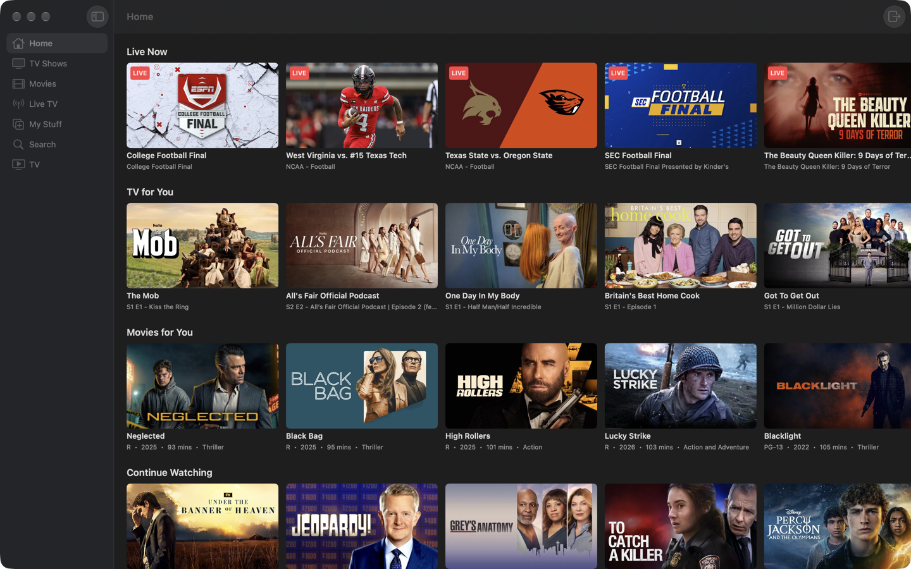

# Wazu

A personal Mac TV player for a Hulu subscription, in SwiftUI. Not for distribution.



Like Wazy (Disney+) and StarPlayrX, it talks to the service's own web API and plays natively:
the same calls hulu.com's player makes (discover.hulu.com for browsing, guide.hulu.com for live
TV, play.hulu.com for the stream) feed a native UI, and AVPlayer plays the FairPlay HLS stream
with keys from Hulu's license server (AVContentKeySession). Sign-in happens once on hulu.com
in a web view; its session cookies are what the API client uses.

You need your own Hulu subscription. The app stores nothing but the session cookies the site
itself keeps in the browser.

## Features

- Sidebar: Home, TV, Movies, Live TV, My Stuff, Search (⌘1–⌘6); ⌘[ goes back a page
- Rows of artwork per hub; series pages list seasons and episodes; a Play button resumes
- Live TV: every channel in the guide with what's on now
- Player: AVKit's floating controls (full screen, Picture in Picture, audio/subtitle
  menus), Play/Pause ⌘P, skip ±10 s, Stop ⌘., Esc closes; the keyboard's media keys work
- Sign-in is remembered between launches (Wazu > Sign Out of Hulu clears it)

## Keyboard

| Shortcut | Action |
| --- | --- |
| ⌘1 – ⌘6 | Sidebar hubs (Search is ⌘6) |
| ⌘[ | Back |
| ⌘P | Play / Pause |
| ⌘← / ⌘→ | Skip back / forward 10 s |
| ⌃⌘T | Float on Top (player window) |
| ⌘. | Stop |
| Esc | Close the player |

## Requirements

- macOS 14 or later
- Xcode 15 or later
- [xcodegen](https://github.com/yonaskolb/XcodeGen) (`brew install xcodegen`) — the Xcode
  project is generated from `project.yml`
- [WazKit](https://github.com/AgentiLoop/WazKit), the Swift package shared with Wazy, cloned
  next to this folder (`project.yml` points at `../WazKit`)

## Build

```sh
git clone https://github.com/AgentiLoop/WazKit ../WazKit   # once, as a sibling of Wazu/
xcodegen generate
xcodebuild -project Wazu.xcodeproj -scheme Wazu -configuration Release -derivedDataPath build build
open build/Build/Products/Release/Wazu.app
```

Re-run `xcodegen generate` after adding or removing files under `Sources/`.

## WazKit

The player, its split-out window, the sign-in sheet and the artwork tiles are
[WazKit](https://github.com/AgentiLoop/WazKit); this app keeps only what is Hulu-specific.
`HuluClient` adopts WazKit's `StreamingService` (certificate, license, and the content
identifier Hulu's license server wants: the whole `skd://hulu/…` key URI), `Item` adopts
`Tile`, and `AppModel.play` hands the player a `NowPlaying` plus the closure that calls
`client.playback(eab:channelId:)`:

```swift
player.play(NowPlaying(id: item.id, title: item.title, subtitle: item.subtitle)) { [client] in
    try await client.playback(eab: eab, channelId: channelId)
}
```

To use a different checkout of the package, change `packages.WazKit.path` in `project.yml`
(or swap it for `url: https://github.com/AgentiLoop/WazKit`, `branch: main`) and re-run
`xcodegen generate`.

## Layout

| File | Role |
| --- | --- |
| `Sources/WazuApp.swift` | App entry point, menus and keyboard shortcuts |
| `Sources/ContentView.swift` | Sidebar, hubs, rows of artwork, series/episode views, live guide, the TV tab |
| `Sources/HuluClient.swift` | The discover / guide / playlist API client (a WazKit `StreamingService`) |
| `Sources/Models.swift` | Models for the Hulu API responses (`Item` is a WazKit `Tile`) |
| `Sources/SignIn.swift` | hulu.com sign-in (WazKit `WebSignInView`) that copies the session cookies out |
| `project.yml` | xcodegen project definition, incl. the WazKit dependency |

## Notes

- Playback is DRM-protected; screenshots and screen recordings of the player come out black.
- This is a personal project that depends on undocumented endpoints; it can break whenever the
  service changes its web player.

## License

[PolyForm Noncommercial 1.0.0](./LICENSE). You may use, modify, and share this software for noncommercial and personal purposes. Commercial use — including building or distributing commercial versions — is reserved exclusively to AgentiLoop.ai, a Logos InkPen LLC company. Contact AgentiLoop for a commercial license.
